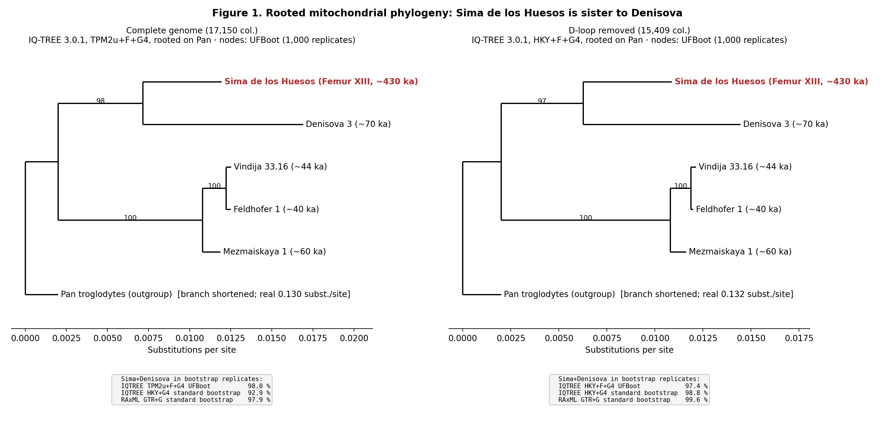

# Correction notice — Sima de los Huesos mtDNA placement

**Author:** Emilio García-Morán · **Date:** 21 October 2026
**Applies to:** the preprint *"Genomic Identity of the Sima de los Huesos Hominins: Convergent Evidence from Mitochondrial and Nuclear DNA"* (Zenodo, doi:[10.5281/zenodo.19389351](https://doi.org/10.5281/zenodo.19389351), v1, April 2026) and the October 2026 manuscript *"Phylogenetic placement of Sima de los Huesos hominins revisited: outgroup rooting resolves apparent mito-nuclear discordance"*.

## Summary

| Part | Status |
|---|---|
| Mitochondrial DNA | **Corrected.** With explicit *Pan troglodytes* rooting, Sima is sister to Denisova, as reported by Meyer et al. (2014). The "basal Sima" placement is withdrawn. |
| Description of Meyer et al. (2014) | **Corrected.** They used a Bayesian analysis (MrBayes, GTR+I+Γ, ~120 mtDNAs including 46 chimpanzee and bonobo genomes, D-loop removed), not an unrooted Neighbor-Joining tree. |
| Nuclear DNA (D-statistics, pairwise distances) | **Under verification.** The figures are withdrawn as results until the original ANGSD outputs are recovered and checked. |
| Phase 2 mtDNA analyses (Jan–Feb 2026) | **Withdrawn.** The input data included non-hominin sequences (see below). |

## 1. Mitochondrial DNA

### What was claimed
Sima de los Huesos was described as the basal sister lineage to (Denisova + Neandertal), with 93% bootstrap support, and the Sima–Denisova affinity reported by Meyer et al. (2014) was attributed to an unrooted Neighbor-Joining analysis.

### What went wrong
The IQ-TREE run that produced the 93% value was performed **without specifying the outgroup** (`-o` was never passed). IQ-TREE itself reports this in its output: *"Tree is UNROOTED although outgroup taxon 'Sima_430ka' is drawn at root"*. The 93% support belongs to the split {Sima, Denisova} | {Neandertals, Pan}. Rooted on *Pan*, that split **is** the Sima + Denisova clade. Reading Sima as basal was a misreading of an unrooted tree. The figures in the manuscript (`figure1_mtDNA.R`, `tanglegramSima.R`) were not drawn from the analysis output: the trees were typed by hand.

The original computations were correct. The phase 3a RAxML-NG bootstrap replicates (March 2026) already supported Sima + Denisova in 98.4% and never recovered Denisova + Neandertals ([`mtDNA_repro/results/LEGACY_PHASE3A_CHECK.txt`](mtDNA_repro/results/LEGACY_PHASE3A_CHECK.txt)).

### Corrected result
Full re-analysis, from GenBank accessions to topology tests: [`mtDNA_repro/`](mtDNA_repro/). Six genomes (Sima Femur XIII KF683087, Denisova 3, Vindija 33.16, Feldhofer 1, Mezmaiskaya 1, *Pan troglodytes*), MAFFT, IQ-TREE 3.0.1, RAxML-NG 1.2.2, explicit rooting on *Pan*.

**Bootstrap support** (% of 1,000 replicates; [`CLADE_SUPPORT.tsv`](mtDNA_repro/results/CLADE_SUPPORT.tsv)):

| Alignment | Analysis | Sima+Denisova | Sima+Neandertals | Denisova+Neandertals |
|---|---|---|---|---|
| full | IQ-TREE TPM2u+F+G4, UFBoot | 98.0 | 2.0 | 0.0 |
| full | IQ-TREE HKY+G4, standard bootstrap | 92.9 | 7.1 | 0.0 |
| full | RAxML-NG GTR+G, standard bootstrap | 97.9 | 2.1 | 0.0 |
| no D-loop | IQ-TREE HKY+F+G4, UFBoot | 97.4 | 1.2 | 1.4 |
| no D-loop | IQ-TREE HKY+G4, standard bootstrap | 98.8 | 0.4 | 0.8 |
| no D-loop | RAxML-NG GTR+G, standard bootstrap | 99.6 | 0.3 | 0.1 |

**Topology tests** (p-AU, 10,000 RELL; [`TOPOLOGY_TESTS.tsv`](mtDNA_repro/results/TOPOLOGY_TESTS.tsv)): "Sima basal" is rejected in all four tests (p = 0.009–0.038); Sima + Denisova is the maximum-likelihood topology in all four (p = 0.95–0.96).

This agrees with Meyer et al. (2014, posterior probability 1) and with Posth et al. (2017), who also rooted on chimpanzee. The mito-nuclear discordance is explained by the replacement model: Sima retains the ancestral, Denisovan-like mtDNA of the early Neandertal lineage, which was later replaced in Neandertals by an introgressed African mtDNA between ~413 and ~268 ka (Posth et al. 2017). A parallel replacement occurred in the Y chromosome (Petr et al. 2020).

### Reproducibility
`bash mtDNA_repro/run_all.sh genbank` re-runs everything (~16 min on 2 cores). A clean-clone re-run reproduces sequences, alignments and all bootstrap frequencies bit for bit. The author's independent run, downloading from GenBank, returned sequence hashes identical to those committed.

## 2. Phase 2 analyses (withdrawn)

Several accession numbers in the phase 2 scripts were typed by hand and never checked against what GenBank returned. Ten of them are not hominin mtDNA:

| Used as | Accession | Actual GenBank record |
|---|---|---|
| Oase 1, Tianyuan, Kostenki 14, Vindija 33, Denisova 4/8 | KX198073/74/75/78/79 | *Agaricus* (fungus), EF1α gene |
| "Sima SH5" | KY751401 | *Henneguya tucunarei* (fish parasite), 18S rRNA |
| Ust'-Ishim | KP295291 | *Phytophthora castaneae* (oomycete), HSP90 |
| Ust'-Ishim | KC758896 | *Ostrinia scapulalis* (moth), ABC transporter |
| "Denisova 2" | NC_024829 | *Nephroselmis astigmatica* (green alga), chloroplast genome |
| "Neandertal" | EU260658 | Simian immunodeficiency virus, partial *tat* gene |

Two of them (NC_024829 and EU260658) were included in the phase 2 "Pleistocene" alignment, which also lacked an outgroup. Phase 2 results, including the "6–0" Sima–Denisova shared-site count, are withdrawn. The affected scripts carry a header notice. The six genomes of the corrected analysis are unaffected. Their GenBank titles and sequence hashes are now validated automatically before alignment ([`validate_sequences.py`](mtDNA_repro/scripts/validate_sequences.py)).

## 3. Nuclear DNA (under verification)

The nuclear section (chromosome 1 only; D = 0.7425, Z = 30.6; 218,757,031 sites; pairwise distances) cannot be reproduced from this repository: the ANGSD commands and outputs were not archived here, and the heatmap scripts contain hand-typed values. These figures are withdrawn as results while the original outputs are recovered. A genome-wide, fully reproducible nuclear analysis is planned as a separate project.

## 4. Status of documents

See [`documents/SUPERSEDED.md`](documents/SUPERSEDED.md). Nothing has been deleted: superseded scripts and manuscripts remain in the repository with notices, so every step can be audited.

## References

Meyer M. *et al.* (2014) *Nature* 505:403–406 · Meyer M. *et al.* (2016) *Nature* 531:504–507 · Posth C. *et al.* (2017) *Nat. Commun.* 8:16046 · Petr M. *et al.* (2020) *Science* 369:1653–1656. Full list with DOIs: [`REFERENCES.md`](REFERENCES.md).
